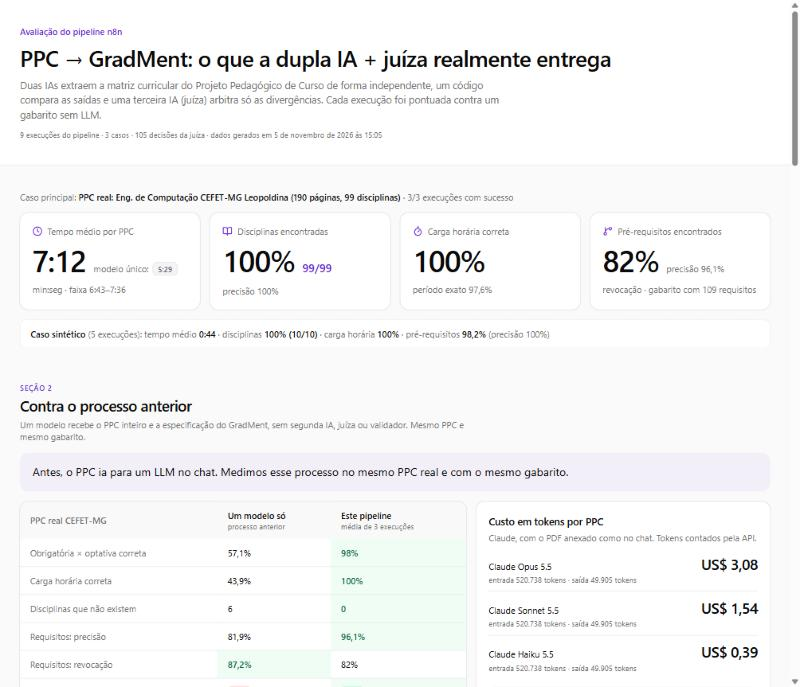
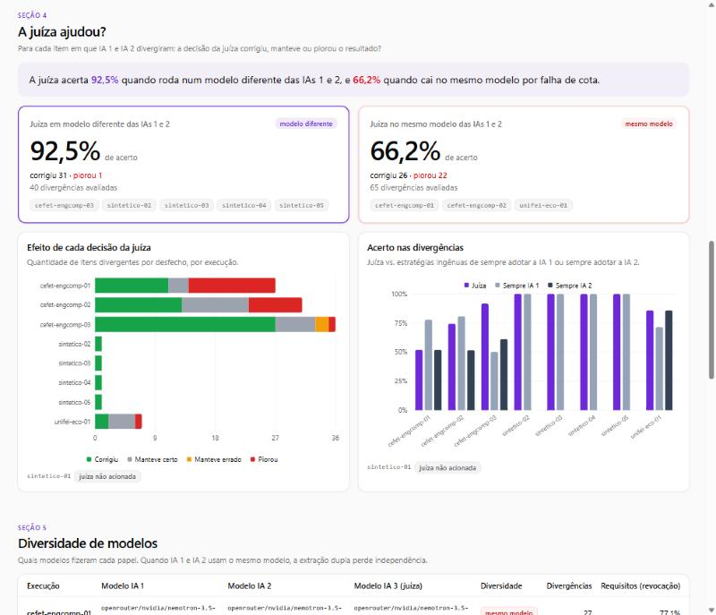

# PPC → GradMent · dashboard feito com vibe coding

**Dashboard publicado em [gradment.vercel.app](https://gradment.vercel.app) com os resultados medidos do pipeline [`ppc-gradment-ia`](https://github.com/catarina051/ppc-gradment-ia).** Eu o construí no v0 com dois prompts e uma rodada no Claude Code. Este repositório guarda o resultado, os prompts exatos e o registro do que foi decisão minha e do que foi da IA.

## O que o dashboard mostra



O pipeline lê o PPC (Projeto Pedagógico de Curso) de uma universidade e gera a matriz curricular do GradMent com duas IAs que extraem de forma independente, um código que compara e uma terceira IA, a juíza, que arbitra só as divergências. O dashboard exibe o acerto de cada execução contra um gabarito feito sem LLM, a diferença entre a juíza rodar em modelo diferente ou no mesmo, a comparação com o processo anterior (mandar o PDF para um LLM no chat) e o custo em tokens.



*Capturas do site publicado em 07/11/2026.*

## Como eu trabalhei: o loop

1. **Escrevi o prompt com regras, não só com o desenho.** Os dados reais ficam num JSON no repositório do pipeline e o app o busca por URL; o prompt proíbe inventar número ou usar dado de exemplo, manda tipar tudo em TypeScript e define o que significa `null` em cada campo.
2. **O v0 gerou a interface.**
3. **Conferi os números exibidos contra o JSON,** depois de cada versão. É conferência manual: este repositório não tem testes automáticos.
4. **Corrigi na origem.** A conferência achou um erro na **avaliação**, não no dashboard: com gabarito parcial, disciplinas fora do gabarito estavam sendo julgadas. Corrigi no script que gera o JSON (`consolidar.mjs`, no repositório do pipeline) e o dashboard se atualizou sozinho pela URL.

## Linha do tempo (3 commits, todos de 05/11/2026)

| Etapa | Ferramenta | O que pedi | O que mudou |
| --- | --- | --- | --- |
| 1 | v0 | [Prompt 1: estrutura](prompts/01-estrutura.md): 7 seções, KPIs, gráficos, tabelas filtráveis, dados por URL | commit `29181b0`: 40 arquivos e 6.052 linhas (3.812 são do `pnpm-lock`) |
| 2 | v0 | [Prompt 2: destaque da conclusão central](prompts/02-destaque-da-conclusao.md): cards da juíza por diversidade de modelo e `revalidate: 300` | commit `ed9f07b`: 3 arquivos, +111 e −2 |
| 3 | Claude Code | Seção "Contra o processo anterior" (qualidade e custo em tokens do Claude), com a linha de base fora dos gráficos do pipeline. **Sem prompt salvo.** | commit `acf12d8`: 4 arquivos, +277 e −21 |
| 4 | Claude Code | Revisão final (veja abaixo) | commit seguinte |

### Revisão final

Três ajustes pequenos, feitos depois de o dashboard estar no ar:

- O selo "A MEDIR" do tempo do modelo único virou "não medido", porque "A MEDIR" parece pendência e o texto precisa dizer o que é.
- O build passou a **validar os tipos**. O v0 deixa `ignoreBuildErrors: true`, e eu o desliguei depois de conferir com `tsc --noEmit` e `next build` que o projeto compila sem erros de tipo.
- O nome do pacote deixou de ser o `my-project` do gerador.

## Quem fez o quê

| | Eu | A IA |
| --- | --- | --- |
| Problema e o que mostrar | Defini as seções, as métricas e as conclusões que devem aparecer | |
| Regras dos dados | Dados reais por URL, nada inventado, `null` com significado, números pt-BR | |
| Interface e gráficos | Pedi e revisei | v0 gerou os componentes (shadcn, Recharts) |
| Conferência dos números | Comparei a tela com o JSON | |
| Seção "Contra o processo anterior" | Pedi | Claude Code escreveu |
| Correção do erro de avaliação | Achei na conferência e decidi corrigir | Claude Code escreveu a correção (commit `3663543`, no repositório do pipeline) |

## O que eu não tenho registrado

Não guardei, iteração por iteração, os erros do v0: só os dois prompts, os três commits e a conferência acima. Também não medi quanto tempo cada etapa levou além das datas dos commits.

## Stack

Next.js 16, React 19, TypeScript, Tailwind CSS 4, shadcn/ui e Recharts. A página é um Server Component que busca [`dashboard-dados.json`](https://github.com/catarina051/ppc-gradment-ia/blob/main/avaliacao/dashboard-dados.json) e o revalida a cada 5 minutos. Para atualizar o dashboard, basta regenerar e publicar esse JSON.

## Rodar localmente

```bash
pnpm install
pnpm dev
```

Precisa de internet, porque os dados vêm do GitHub.

## Estrutura

- `app/`: página e layout.
- `components/dashboard/`: as seções (KPIs, acerto por campo, juíza, diversidade de modelos, cobertura, decisões, comparação com o processo anterior).
- `lib/dashboard-data.ts`: a URL dos dados e os tipos.
- `prompts/`: os dois prompts enviados ao v0, exatamente como enviados.
